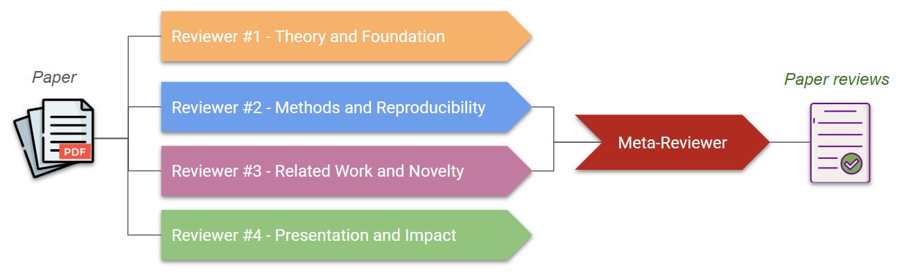
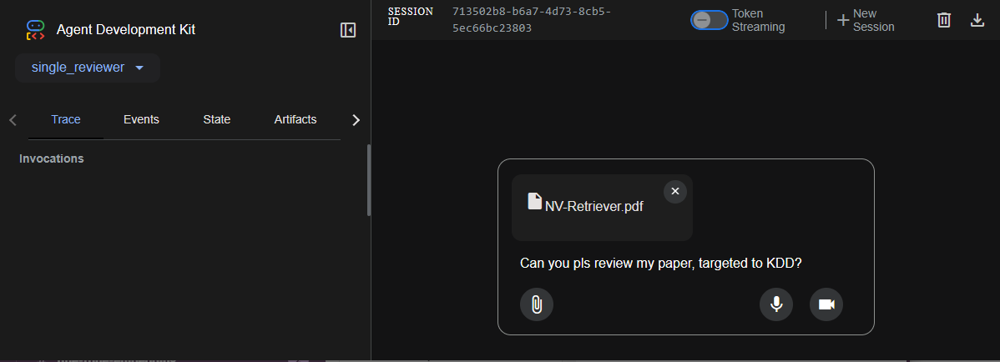
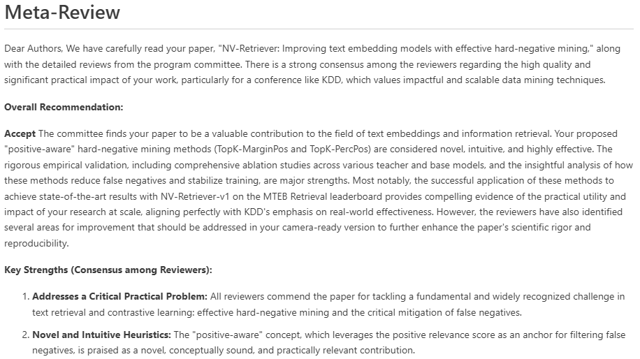

# Agentic Paper Reviewer system with ADK

This repo demonstrates how to use ADK for creating a simple agentic system that emulates paper review process by an academic conference Program Commitee. The code demonstrates ADK workflow agents - `SequentialAgent` and `ParallelAgent` - which are useful to create deterministic pipelines. The agents are powered by Google Gemini API.


This is the workflow:



1. User messages the system with the desired conference to submit a paper and attach a paper PDF.
2. Each reviewer agent, configured to have a different profile/emphasis, perform an independent review of the paper in parallel.
3. The meta-reviewer agent reads all the reviews, summarizes the major strengths / weaknesses of the paper and provides the final decision on acceptance/rejection.

The full description of this project can be found in this [blog post](https://gspmoreira.medium.com/building-an-agentic-system-with-adk-and-gemini-to-simulate-a-paper-review-committee-eabad29f6172).

## Installing
```bash
# Clone the repo
git clone https://github.com/gabrielspmoreira/agentic_paper_review_adk.git
cd agentic_paper_review_adk/
# Creates .venv if it does not exist and install dependencies from uv.lock / pyproject.toml
uv sync
```

## Configure the environment variables
In order to run this code, you need to configure some environment variables.
Run this command to create a `.env` file.

```bash
cp .env.example .env
```

You have two options for using Gemini via Google Gen AI SDK and Agent Development Kit (ADK).

### 1. Gemini Developer API - Google AI Studio
1. Get an API key from [Google AI Studio](https://aistudio.google.com/apikey).
2. Set these environment variables in `.env`.

```bash
GOOGLE_API_KEY=<your-api-key>
GOOGLE_GENAI_USE_ENTERPRISE=false
```

### 2. Gemini - Google Cloud Gemini Enterprise (Vertex AI)
1. Create a Google Cloud project, enable Vertex AI API and authenticate on gcloud cli ([instructions](https://google.github.io/adk-docs/get-started/quickstart/#gemini---google-cloud-vertex-ai)).
2. Set these env variables in `.env`

```bash
GOOGLE_GENAI_USE_ENTERPRISE=true
GOOGLE_CLOUD_PROJECT=<your-project-id>
GOOGLE_CLOUD_LOCATION=<your-location>
```

You can also set MODEL env variable if you want to use a specific LLM backend
```bash
MODEL=gemini-3.8-flash
```

## Starting ADK Web UI
1. Start the ADK Web UI with the following command. The URL of ADK Web UI will be printed by the command.  

```bash
adk web agents/ --allow_origins="*"
```

*Note*: If you are using Google Cloud Shell, click in the *Web Preview* button at top right of Cloud Shell and click in *Change Port* if needed (e.g. 8000) and then click in *Preview on port 8000*.  

2. When the browser loads, the ADK Web UI webapp will be presented.  
3. Select in the top-left of the webapp one of the available agents: `single_reviewer` or `review_commitee`.  
4. On the right panel, type *I would like to submit this paper to KDD*, click in the attachment button to attach a paper PDF and press enter to  submit. After some seconds/minutes, the reviews and meta-review will be generated.

*Note*: If the agent answer is not shown in the chat panel, select the `State` tab in the top-left, and you will be able to see the answer under the `review` state (`output_key` set for the agent). 

5. If you want reviews and meta-review to be in a standard schema format, set `OUTPUT_JSON=True`, and it will set the `output_schema` argument from `LlmAgent` constructor.         

## agents-cli and Gemini Enterprise integration

You can install [agents-cli](https://google.github.io/agents-cli/) for integration with Gemini Enterprise Platform.

### Runs ADK web UI locally
```bash
agents-cli playground
```

### Deploys agent to Gemini Enterprise Platform (single_reviewer agent)
Run this command and you agent should be deployed at https://console.cloud.google.com/agent-platform/runtimes?project=YOUR_DEV_PROJECT_ID
```bash
agents-cli deploy --config agents-cli-manifest.yaml --project YOUR_DEV_PROJECT_ID --clear-env-vars --no-confirm-project
```

### Runs remote inference on the agent deployed to Gemini Enterprise Platform
```bash
agents-cli run \
  --url "https://us-east1-aiplatform.googleapis.com/v1/projects/<projet_name>/locations/us-east1/reasoningEngines/1487514981236989312" \
  --mode adk \
  --file paper/NV-Retriever.pdf \
  "Please review this paper for CIKM."
```

### Publishes to Gemini Enterprise app
Run this command and the agent should be available for your [Gemini Enterprise apps](https://console.cloud.google.com/gemini-enterprise/apps)
```bash
agents-cli publish gemini --interactive
```

## Examples of reviews
In the folder [review_examples](review_examples/) you can find examples of reviews and meta-reviews for a [paper](https://arxiv.org/pdf/2407.15831) I co-authored with my colleagues at Nvidia.

Here some example of part of a meta-review.

